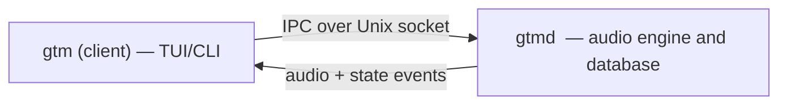

`gtm` is a reimagined audio player for the terminal, inspired by the strengths and limitations of existing implementations and (shamelessly)  borrows a lot of the good parts from them.

Designed from the ground up with integration with other terminal tools (via IPC), `gtm` is actually the client for `gtmd`, the daemon process responsible for playback. As a client, the `gtm` command launches the main TUI (terminal user interface) which is keyboard driven and has floating pickers for most features/actions. 

The daemon owns audio output, the library database, network providers, and
  the playback state machine. A client just sends requests; the daemon streams events back
  in real time. Multiple `gtm` processes (or any clients) can attach to the same daemon simultaneously.

Using this approach of having the client separate from the daemon (which is like a server) we can have uninterrupted playback that is not attached to our terminal session.

The client is free to attach and detach as the user pleases, allowing the flexibility to control playback without having to leave the terminal. This is a big deal if one wants to avoid too much context switching.

Terminal (power) users have an obsession with integrating their essential tools
into their editor (`nvim`, btw). `gtmd` makes that possible: clients can send
remote commands and subscribe to the **pulse** socket, which carries updates as
MessagePack-encoded frames. 

> [!NOTE]
>
> [Try gtm.nvim](https://github.com/prjctimg/gtm.nvim) to see what intgration with `gtmd` feels like.
>

### Why not just use `mpd` + already existing clients 

We're living in the age of code abundance and I wanted to challenge existing implementations yet derive inspiration from them as well. 

For instance, `mpd` does not handle palette extraction but `gtmd` does allowing other programs to hack on top of this returned palette, for instance this can be mapped to your entire desktop theme, allowing one to enjoy reactive theming everywhere when there's active playback.

As far as clients are concerned, most of the ones I tried looked too cluttered, looked to vague or just sucked in general (no offence). We have better terminal emulators now and the quality of the TUI apps must improve too. 

### Roadmap 

The goal of this project is to match provider support parity with (the legendary) `cliamp` whilst offering a better TUI and separating the daemon from the client so that other users can hack on top of it with ease.

Standardizing the protocol is an ongoing effort so that clients need not to worry about how to communicate with the daemon, hacking `gtmd` should be as simple as sending a command to the service via a socket.

Users should also be able to get  `gtm` from their preffered package manager and consider this an open call for contributors to start community maintained packages.

Support on Windows is planned when the feature set is stable and well tested on current Unix like platforms. Users interested in seeing this happen quicker are free to open an issue and share their suggestions on how to achieve this.

Conclusion

All in all, this is a tribute to the open source culture and not meant to have every feature in every terminal audio player, like Ghostty, this project is more focused on redefining what is possible with an audio player.

Good to know, this project is not affiliated with any third parties integrated into it. 

> PS - And if any pro Rust wizard is reading this, (please) feel free to roast the source for anti-patterns and optimization techniques.

